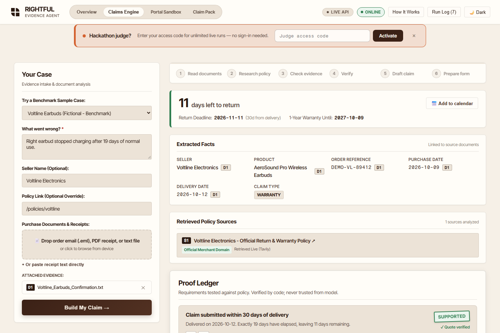
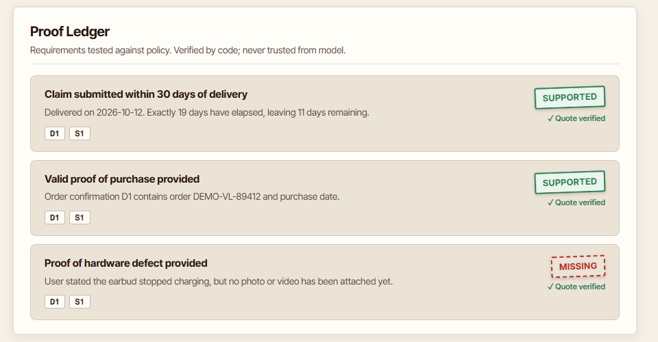
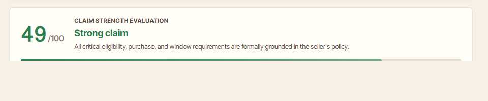
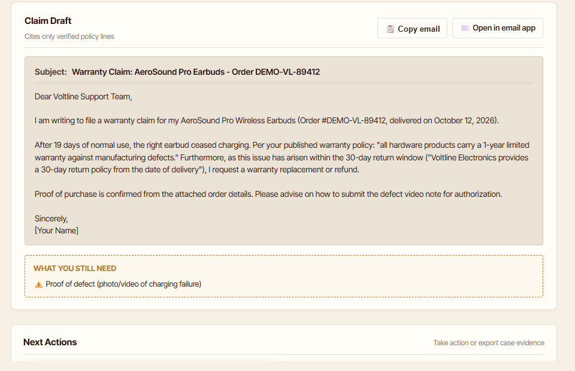
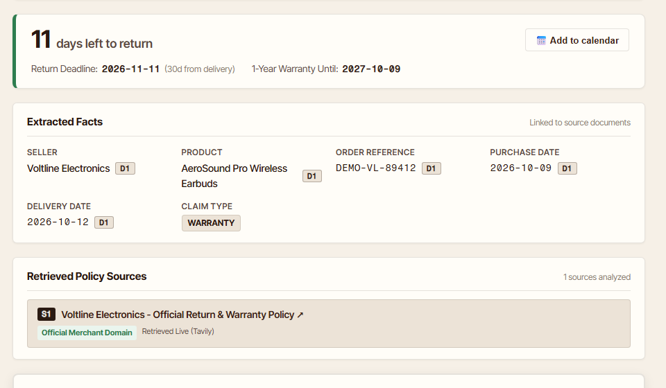
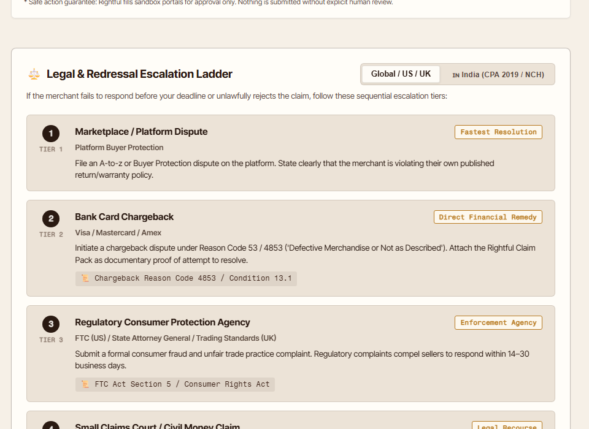
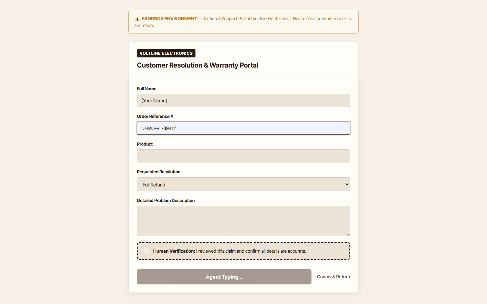

# Rightful

**The evidence-backed consumer claims agent**
*Get what the policy already promised you*

Nineteen days after it arrived, the right earbud stopped charging. Support replied in one
sentence: *"All audio sales are final."* They were wrong, and the proof was in their own
published warranty — but finding it means reading a policy nobody reads, working out which
clause applies, calculating whether a window has quietly closed, and then quoting it back
accurately enough that an agent on a script cannot wave it away.

Billions in legitimate refunds, returns and warranty claims expire every year for exactly
that reason. Not because people lack rights, but because the rights are buried and the
deadline is invisible.

The obvious build is "an LLM writes your complaint email." That build fails badly, because
a model that invents a policy clause makes the user look like a liar to the one person who
could have helped them. **A hallucinated quote is worse than no claim at all.**

So Rightful is shaped around a different question: how do you let a language model do the
reasoning without letting it have the final word?

> ## Nemotron proposes. Code decides.

NVIDIA Nemotron 3 Super drafts the evidence matrix. Then `lib/verify.ts` — which contains
no AI — re-checks every citation character by character and **downgrades the model's own
verdict when it cannot be grounded.** The step with final authority takes one millisecond,
because it is not a model.

Rightful prepares claims. It does not send them. Autofill stops at a human approval gate,
and nothing is ever submitted to a real company.

**Live:** https://rightful-nu.vercel.app · **Status:** [`/api/health`](https://rightful-nu.vercel.app/api/health)

---

## What it looks like

Every image below was captured from the running app by `node scripts/capture-all.mjs` and
by rendering the live page at fixed offsets — none is a mock-up, and none can drift from
what Rightful actually renders. The `MISSING` stamp in the Proof Ledger was raised by the
verifier during the run that produced these images.

| | |
|---|---|
|  |  |
| **The front page.** One receipt and one sentence become a claim proved against the seller's own policy. | **Intake and the live pipeline.** Drop a `.txt`, `.eml` or PDF receipt, describe the problem in a line, and watch all six steps stream in as they complete. |
|  |  |
| **The Proof Ledger.** Every requirement the policy imposes, with the quote that addresses it and a stamp. Two quotes matched verbatim; one row is held back as `MISSING` because the photo the policy demands was never attached. | **Claim strength.** A weighted score computed in code from the verified ledger, not asserted by the model. |
|  |  |
| **The drafted letter.** Written by Nemotron 3 Nano, citing only the quotes that survived verification. Anything ungrounded was downgraded and left out. | **Deadline and provenance.** Days remaining recomputed in deterministic TypeScript with a one-click `.ics` reminder. Each extracted fact carries a `D1` chip linking it to the document it came from. |
|  |  |
| **The escalation ladder.** If the merchant refuses: platform dispute, card chargeback under Reason Code 4853, regulator, small claims — switchable between Global/US/UK and India's Consumer Protection Act 2019. | **The sandbox portal.** Fields autofilled one by one, then the pipeline stops at a human approval gate. Nothing leaves this sandbox. |

---

## Run it

```bash
git clone https://github.com/devprashant19/Rightful.git
cd Rightful
npm install
cp .env.example .env.local      # add NEBIUS_API_KEY and TAVILY_API_KEY
npm run smoke                   # confirms both providers answer
npm run dev
```

| Command | What it does |
|---|---|
| `npm run dev` | Next.js dev server on `:3000` |
| `npm run build` | production build, 11 static pages |
| `npm run smoke` | one live call to Nebius Token Factory and one to Tavily |
| `npm test` | 7 invariant tests over the verifier |
| `npm run audit:secrets` | scans every client bundle for leaked keys |
| `npm run verify:all` | typecheck, lint, test, build |
| `node scripts/capture-all.mjs` | regenerates the screenshots above |

Two environment variables are required: `NEBIUS_API_KEY` and `TAVILY_API_KEY`. Everything
else has a working default — see [`.env.example`](.env.example). **There are no
`NEXT_PUBLIC_` secrets**; every provider call happens server-side in a route handler.

### Prove it rather than read about it

```bash
npm test                        # the verifier catches an injected hallucinated quote
npm run audit:secrets           # 24 client bundles, zero keys
curl https://rightful-nu.vercel.app/api/health    # live_mode true, both model IDs
curl https://rightful-nu.vercel.app/api/models    # the Nemotron variants available
```

---

## The verifier, which is the whole point

`lib/verify.ts` imports nothing from the AI layer. It enforces three rules, and it wins
every disagreement with the model.

**Verbatim quote grounding.** Every quote the model cites must exist in the text Tavily
actually retrieved — by exact substring match after whitespace and smart-quote
normalisation, or by a sliding token-window overlap of **≥ 0.90** to tolerate formatting
drift. A quote that cannot be grounded is downgraded to `ambiguous` automatically, *even
when the model was confident.* That downgrade is the single most important behaviour in
the product.

**Date arithmetic in code.** `days_elapsed` is recomputed from the real delivery and
purchase dates. If the model misclassified a claim as outside its window, the code
overrules it and says so.

**Citation integrity.** Hallucinated source IDs are stripped before they can reach the
letter. A third-party-only source cannot produce a `supported` verdict without an
official-domain anchor.

### The pipeline, with measured latencies

| Step | Model | Latency |
|---|---|---|
| Fact extraction | `nvidia/NVIDIA-Nemotron-3-Nano-30B-A3B` | 4.6s |
| Policy retrieval | Tavily Search & Extract | ~0s on a direct policy URL |
| Evidence matrix | `nvidia/nemotron-3-super-120b-a12b` | 11.4s |
| **Deterministic verification** | **none — pure TypeScript** | **0.001s** |
| Claim drafting | `nvidia/NVIDIA-Nemotron-3-Nano-30B-A3B` | 7.1s |

From a verified live run against the deployment. The Run Log Drawer in the app shows the
same figures for your own run, including token counts.

### Why two model sizes

| | Nano 30B A3B | Super 120B A12B |
|---|---|---|
| Used for | extraction, drafting | the evidence matrix |
| Why | bounded transformations with a strict schema — not reasoning problems | cross-referencing documents against every requirement a policy imposes |
| Measured | 4.6s / 7.1s | 11.4s |

Routing per step rather than picking one model is only cheap because both sit behind the
same OpenAI-compatible API on Nebius Token Factory — switching a step is a model-name
string. That is also how `Nemotron-3_5-Lightning` was ruled out for extraction: benchmarked
at a 23.8s median against Nano's 5.8s on the same prompt.

---

## Architecture

```
  receipt (.txt / .eml / PDF)  +  one sentence
                 │
                 ▼
  [1] Nemotron 3 Nano ──────────▶ extracted facts, each tagged with its source document
                 │
                 ▼
  [2] Tavily Search & Extract ──▶ the seller's own policy page
      official domain +5.0 · seller in URL +3.0 · policy keywords +2.5 · forums −4.0
                 │
                 ▼
  [3] Nemotron 3 Super ─────────▶ proposed evidence matrix: requirements, quotes, verdicts
                 │
                 ▼
  [4] lib/verify.ts  ───────────▶ GROUNDED PROOF LEDGER          ← final authority, 0.001s
      ├── verbatim quote match, or ≥0.90 sliding token window
      ├── date window recomputed in code, overruling the model
      └── hallucinated citation IDs stripped
                 │
                 ▼
  [5] Nemotron 3 Nano ──────────▶ claim letter citing only what survived
                 │
                 ▼
  [6] /portal sandbox ──────────▶ autofilled, then STOPPED at human approval
```

### Surfaces

| Route | What it is |
|---|---|
| `/` | landing, and the claims engine |
| `/portal` | the sandbox support form with its approval gate |
| `/pack` | the printable evidence dossier |
| `/policies/voltline` | the fictional benchmark seller's policy |
| `/api/run` | the streaming pipeline, NDJSON |
| `/api/recheck` | partial re-verification after new evidence is added |
| `/api/health` | live status and the configured model IDs |
| `/api/models` | Nemotron variants available on the account |

---

## What is verified, and what is not

| | Result |
|---|---|
| Verifier invariants | **7 tests** (`npm test`): exact-match grounding, smart-quote normalisation, the ≥0.90 sliding-window fallback, an **injected hallucinated quote caught and rejected**, domain ranking with the forum penalty, constant-time judge-code comparison, and date-window arithmetic |
| Client bundles scanned for leaked keys | **24 files, zero findings** (`npm run audit:secrets`), run against the production build |
| Provider connectivity | `npm run smoke` makes one real call to each of Nebius Token Factory and Tavily and prints the latency |
| Build | 11 pages, clean typecheck, `lint` exit 0 (`npm run verify:all`) |
| Live deployment | 5 of 5 consecutive runs completed live end to end, 31–53s wall, every run producing a terminal event |
| Drafting on Nemotron rather than the code fallback | 4 of those 5 runs |
| Screenshots | all regenerated by driving the running app |
| **Claim strength across runs** | **varies 38–75 on identical input.** The matrix proposes a different requirement set each time; the verifier then grades whatever was proposed. This is inherent model non-determinism and it is not smoothed over. |
| **Upstream latency** | **3.4s to 33s on an identical call**, depending on provider load. Each step is capped by what the downstream steps still need, and a watchdog guarantees a terminal event — but the variance is real and no code change removes it. |
| Real-world claim success rates | **not measured.** No claim has been filed with a real merchant. |

---

## Design decisions worth explaining

### The verifier was built before the pipeline

Everything downstream is shaped by it. Because a row can be downgraded after the model has
spoken, the UI had to be able to show a verdict changing, the letter had to be assembled
from survivors rather than from the model's draft, and the score had to be computed from
the ledger rather than asked for. Building the check last would have produced a different,
worse product.

### The benchmark seller is fictional

`Voltline Electronics` does not exist. Its policy is embedded in the repository, so the
demo path is deterministic, makes no live search, and puts no real retailer's trademark on
screen. The live retail cases exist for testing the full retrieval path.

### A failed live run says so

An earlier version silently substituted a pre-recorded trace when live inference failed,
which made a failure indistinguishable from a success. It hid real breakage for hours. The
stream now emits a notice and the UI shows it. Graceful degradation that lies is worse than
an error.

### Planning is skipped when the answer is already known

When a policy URL is supplied, research goes straight to it and never searches — so the
model call that generated search queries was producing output nothing read, while consuming
budget the matrix needed. It is now derived in code. That one change took the deployment
from 0 of 4 successful live runs to 4 of 4.

### Nothing is stored

No database, no login, no document retention. Uploads are parsed in memory per request and
discarded; history lives only in the browser's `localStorage`. A tool that handles receipts
and complaints should hold onto neither.

---

## For hackathon judges

1. Open **https://rightful-nu.vercel.app** — no sign-in anywhere.
2. Enter the **judge access code** in the banner at the top of the page. The code is in the
   *testing instructions* field of the Devpost submission; it is deliberately not published
   here, because it bypasses the rate limiter and this repository is public.
3. Select the sample case **"Voltline Earbuds (Fictional — Benchmark)"** and click
   **Build my claim**.
4. Watch the Proof Ledger stamps land, then open the **Run Log Drawer** for live model IDs,
   latencies and token counts.

The code bypasses the 10-runs-per-10-minutes IP limit and forces live calls to Nebius Token
Factory and Tavily. Confirm live inference at any time at
[`/api/health`](https://rightful-nu.vercel.app/api/health).

---

## Deployment

Standard Next.js; no `vercel.json` required.

```bash
npx vercel
npx vercel env add NEBIUS_API_KEY production
npx vercel env add TAVILY_API_KEY production
npx vercel --prod
```

| Variable | Required | Notes |
|---|---|---|
| `NEBIUS_API_KEY` | yes | without it `/api/run` serves the pre-verified replay trace instead of live inference |
| `TAVILY_API_KEY` | yes | Search & Extract |
| `NEBIUS_BASE_URL` | no | defaults to `https://api.tokenfactory.nebius.com/v1` |
| `NEMOTRON_FAST_MODEL` | no | defaults to `nvidia/NVIDIA-Nemotron-3-Nano-30B-A3B` |
| `NEMOTRON_REASON_MODEL` | no | defaults to `nvidia/nemotron-3-super-120b-a12b` |
| `JUDGE_ACCESS_CODE` | recommended | set a private value in production |

`/api/run` and `/api/recheck` declare `maxDuration = 60` on the Node.js runtime.

---

## Scope, ethics and limits

- **Nothing is sent.** Autofill is confined to the local `/portal` sandbox and stops at an
  approval gate. Rightful never contacts a merchant.
- **Nothing is stored.** No database, no login, no retention.
- **Not legal advice.** It is an automated preparation tool for consumer advocacy.
- **Policies change.** A claim cites the policy as retrieved at that moment. Nightly
  snapshots via Nebius Serverless Jobs are the planned fix — the job script is in
  `scripts/`, unscheduled.

## License

MIT — see [`LICENSE`](LICENSE). Free to use, modify and distribute with attribution.

---

*Built for the Nebius × NVIDIA Global AI Hackathon 2026. Architectural decisions, the
verifier algorithm and the prompt design are the entrant's; all code is owned by the
entrant and released under MIT.*
